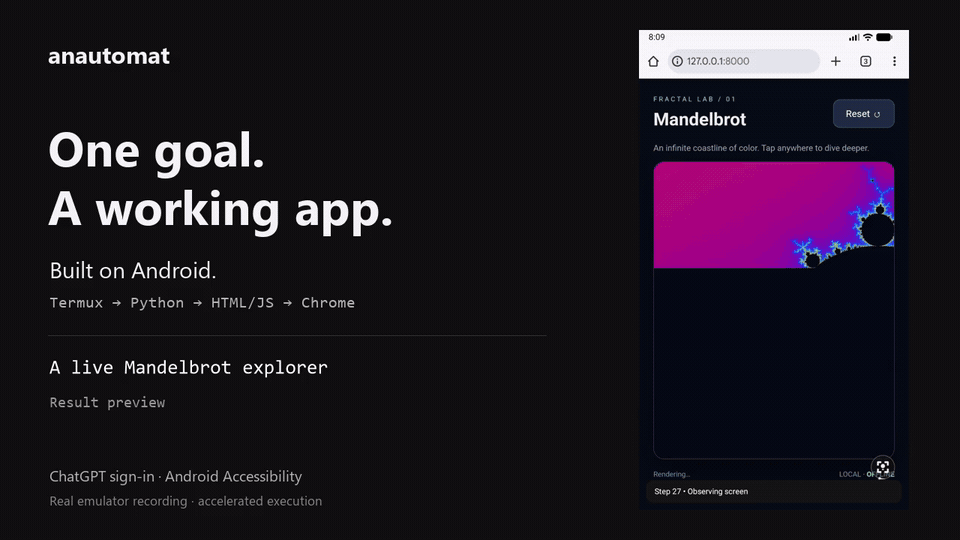

# anautomat

**Give your phone a goal. Let it build the tool.**

An Android agent that sees the screen, operates across apps, and runs entirely on the device. Sign in with ChatGPT and keep control through a small floating button.

[Download APK](https://github.com/fuba/anautomat/releases/latest/download/anautomat.apk) · [Watch the demo](https://github.com/fuba/anautomat/releases/download/v0.1.2/anautomat-fractal-demo.mp4) · [Security](SECURITY.md)

[](https://github.com/fuba/anautomat/releases/download/v0.1.2/anautomat-fractal-demo.mp4)

One goal. **32 steps. A working Mandelbrot explorer.** anautomat installs Python in Termux, writes an HTML/JavaScript canvas app, starts a server on `127.0.0.1`, opens Chrome, zooms twice, and resets the view. The generated app has no external code dependencies.

The video shows a real emulator run. The 54-second edit labels accelerated sections; the GIF is a further sped-up preview. [Full recording](https://github.com/fuba/anautomat/releases/download/v0.1.2/anautomat-fractal-full.mp4), [exact goal and setup](docs/demo/README.md), and [generated source](docs/demo/generated-index.html) are available. The PC installed the APKs and recorded the emulator; inference and every goal action ran inside Android.

## Code and macros

The agent writes **Starlark**: short, Python-like programs that run entirely on the phone. anautomat supplies `ui.fill("Result", value)`, `ui.tap("Verify")` and other guarded operation APIs. The interpreter receives data and queues operations in a fresh permissionless Android process. No compiler, PC bridge or runtime download is needed on the phone.

```python
def main():
    total = 0
    for n in range(1, 101):
        total += n * n
    ui.fill("Result", str(total))
    ui.tap("Verify")
    return total
```

This program completed the offline Android smoke test in two model steps. [Exact run and screenshot](docs/automation-evidence.md).

Macros execute up to 32 validated operations sequentially without a model request between them. Label-based targets are resolved immediately before each operation and must be unique. Package guards, optional visible-text guards and settling delays prevent a stale batch from continuing after a mismatch. Pause or failure discards remaining actions; manual resume takes a fresh screenshot. Disable Starlark execution in Settings when it is not needed. [Tool APIs, limits and security boundaries](docs/automation.md) · [On-device test evidence](docs/automation-evidence.md).

## Install

1. Download **anautomat.apk** from GitHub Releases. Android 11 or later is required.
2. Install the APK and open anautomat. Android may ask you to allow installation from the browser or file manager.
3. Open **Accessibility settings** and enable anautomat. On devices that restrict accessibility for sideloaded apps, use **App info → Allow restricted settings**, then return to Accessibility settings.
4. Choose **Continue with ChatGPT** and complete sign-in and consent in the system browser. After the app verifies and saves the credentials, it returns to the control center. If your device blocks the automatic return, tap **Open anautomat** on the completion page.
5. Reload the available models if needed, enter a goal, and press **▶**.

Execution needs internet access and a ChatGPT account with access to the requested plan-inference scope and models. Sign-in happens on the Android device. No PC bridge, Codex CLI, API key, or adb connection is required after installation. This is an independent experimental project, not an OpenAI or Google product.

Release APKs use a persistent release signing certificate. Development APKs use a separate debug certificate and cannot be updated in place to the release build. The application ID remains `dev.androiduse` for compatibility with the prototype's data and settings.

### Updates on the phone

From v0.1.10, the app checks this repository's latest stable GitHub Release approximately every six hours and when opened after that interval. Android battery and background restrictions can delay checks. The Updates card has an automatic-check switch and a manual check button. Allow notifications to receive a one-time notification for each new version.

Tap **Download**, then **Install**. The first time, Android asks you to allow installation from anautomat; return and tap Install again. Android always asks for installation confirmation. End any active or paused Goal before installing. Updates preserve application data and sign-in. Installing v0.1.10 itself requires downloading the APK once through the link above.

The updater accepts only this repository's stable versioned release assets, bounds downloads, checks SHA-256 against `SHA256SUMS` and GitHub's asset digest when present, and requires the same package ID and signing certificate as the installed app with a strictly newer version. APKs are kept in private cache and exposed only through a read-only URI grant to Android's installer. A development build cannot install production releases because their signing certificates differ. No additional update SDK, server, API key, or PC is required.

## Controls

- The translucent circular button stays above other apps while the accessibility service is connected. Drag it to reposition; tap it to open the menu in place.
- Opening the menu keeps execution running. The control center and floating menu use the same goal-control component: microphone, primary play/pause button, stop, and current status. The primary button starts an idle goal, pauses a running goal, resumes a paused goal, or continues after the step limit. Its tooltip and accessibility label describe the current action.
- The microphone opens Android's speech recognizer. Review the recognized goal before running it. Speech service availability and audio processing depend on the installed provider.
- **■** ends the current session in either surface. **Open control center** returns to the app. Sign-in cancellation is a separate action in the connection section.
- Both GOAL fields share a persistent draft and synchronize while typing, including voice input from either surface. During execution, pause, or a step-limit stop, both fields show the active goal and editing/voice input is locked. End the session with **■** before changing the goal.
- The white orbiting point indicates execution. A small pause badge indicates pause. The bottom ticker shows each new progress message once, for up to eight seconds, when the app and menu are hidden. Swipe it left or right to dismiss that message; streaming appends do not restore a dismissed message. Seen messages stay suppressed across app switches and overlay recreation. Messages received while the app or menu is open are not replayed later. Full history remains in the app log.

The default step budget is **100** observations/inference requests. Change **Step limit** in the app. On exhaustion, **▶** continues in either surface. It grants another configured budget while preserving the active goal, action history, cumulative step number, token usage and log file. Execution/continuation state is held in memory and is lost when the service or process stops. Each inference has a 150-second timeout.

Temporary response failures, interrupted streams, network timeouts and eligible HTTP failures trigger at most two automatic retries, with approximately 2- and 4-second backoff plus jitter. Valid `Retry-After` delays are honored; delays longer than a day pause instead. Authentication, permission, quota and invalid-response errors pause immediately. After retries are exhausted, press the play icon to resume manually. Each retry captures a fresh screen and counts toward the configured step budget. Only inference is retried; partially streamed actions are discarded and device actions are never replayed by the retry mechanism. The [OpenAI error guide](https://developers.openai.com/api/docs/guides/error-codes) describes the backoff and rate-limit behavior used here.

Resume preserves an in-memory session while the accessibility service stays alive. Ending the session, force-stopping the app or restarting the service does not retain a resumable execution; saved goals and exported logs remain available.

The overlay is hidden briefly during screen capture and input so it does not intercept the target app. Android can suppress accessibility overlays on protected system screens; visibility is not guaranteed on every surface. Already dispatched gestures may finish after pause or stop. Late inference results from a cancelled generation are ignored.

## Language

English is the default interface language; Japanese translations are included. Android 13 and later expose **App language** in the control center. Earlier versions follow the system locale. Voice-recognition language and planner reasons follow the app locale. Existing goals and historical logs retain their original language.

Repository documentation, comments, workflows and release notes are written in English. Japanese is confined to translation resources and escaped localization test data.

## Logs

The LOG text area supports scrolling, selection and copying. It uses one line break per entry. Auto-scroll follows new entries only when you are already at the bottom. The on-screen history retains up to 500 entries or 150,000 JSON characters and is encrypted in app-private storage.

Choose **Save folder** to enable automatic UTF-8 text export using Android's Storage Access Framework. The selection persists across restarts. Each new goal gets a name such as:

```
2026-10-15_16-55-00-123_Open Settings.txt
```

Names use the start time in Japan Standard Time, including milliseconds, followed by the first sentence of the goal shortened to 36 Unicode characters. Forbidden filename characters are removed. This title is a deterministic excerpt, without an additional model call.

New entries, pause, continuation and completion update the same file in the background. The 500-entry UI limit does not truncate the run's exported history. Selecting a folder after a run exports the retained last run; before any run using the new logger, the existing UI history is exported as **Log history**. **Auto-save off** stops future updates. **Clear log** clears the UI history and leaves existing exports intact. Save errors appear in LOG.

Local history and the latest-run recovery copy are encrypted with Android Keystore. Exported files are ordinary text in the folder you choose and may contain goal text and public reasoning summaries. No authentication tokens, raw API responses or private chain-of-thought are logged.

## Data and supported operations

During execution, screenshots, visible UI text, installed-app labels, the goal and action history are sent directly to the official OpenAI Responses endpoint. OAuth tokens are encrypted, backed up neither by Android nor this repository, and refreshed when required.

Supported actions: launch app, tap, long press, swipe, replace focused editable text, commit text to custom inputs such as Termux and press Enter (Android 13+), Back, Home, Recents, notifications, quick settings, wait and completion/block reporting. The planner re-observes the screen after each action.

Protected screens, unlocking, biometric authentication, root-only operations, arbitrary key injection beyond Enter, multitouch and input fields without an Android input connection are unsupported. Sensitive actions require explicit goal authorization in the model prompt; this does not constitute a complete approval system. The app has not been prepared for Play Store distribution.

Completed responses contribute to displayed goal token usage. A numeric rate-limit remaining-tokens header is shown only when the API provides it. This is not the remaining allowance of the entire ChatGPT plan. Cancelled or failed requests without a completed usage event cannot be counted.

## Build and test

The app uses Java and native Android resources, with a Go implementation of Starlark and a small JNI byte-array bridge. There is no Gradle. Builds require Windows, PowerShell 7, Python 3.10+, a JDK 17+, Android SDK **platform 36 / build-tools 36.0.0**, and **NDK 29.0.14206865**. CI uses preinstalled Java 21 and Android SDK/NDK packages from `windows-2025`. The scripts fetch a pinned Go SDK and module archives only after a seven-day cooldown and upstream/hash checks. Go builds use a local file proxy with network resolution disabled; the phone receives only the compiled interpreter.

Set `ANDROID_HOME` and `JAVA_HOME` when the tools are not in their standard Android Studio locations. `ANAUTOMAT_JAVA_HOME` overrides JDK selection; `ANAUTOMAT_PYTHON` overrides the Python executable.

```powershell
./scripts/test.ps1
python -m unittest discover -s tests -p 'test_*.py' -v
./scripts/build.ps1
./scripts/start-emulator.ps1
./scripts/install.ps1 -Serial emulator-5556
./scripts/test-device.ps1 -Serial emulator-5556
```

`build/anautomat.apk` is the development APK. The dedicated emulator is named `AndroidUse_Test` and uses port 5556. Install the SDK's `system-images;android-36.1;google_apis_playstore;x86_64` package before creating it. Device tests check Keystore encryption/tamper rejection, shared-goal synchronization and English/Japanese resources; if an export folder is configured, they also check actual SAF file writes and same-file updates using a separate temporary test file.

Tests download only the locked, checksum-verified test JSON library after its cooldown. Builds do not install or upgrade SDK packages. Do not use `uiautomator dump` during an active goal: UI Automation can suppress the accessibility service. Screen capture is safer for observing a live run.

## CI and releases

Main pushes, pull requests and a weekly schedule run the build, JVM tests, security-gate regression tests, dependency age/integrity checks, GitHub advisory audit, Gitleaks secret scanning, actionlint, Android manifest policy, translation parity and CodeQL for Java/Go/C/Python/Actions. High-severity CodeQL findings fail the job. Development APKs are available as workflow artifacts.

CI downloads have a **seven-day cooldown**, exact versions and SHA-256 checksums. Actions are pinned to full commits and their release age is checked before execution. The CodeQL bundle is explicitly locked; the build never requests an unpinned latest SDK/JDK. See [SECURITY.md](SECURITY.md) for the trusted runner-image boundary and failure behavior.

Push a semantic version tag such as `v0.1.0` to trigger the release workflow. Security checks run first. Only then does it build and sign `anautomat.apk`, attest provenance and publish an APK plus `SHA256SUMS` to GitHub Releases. Signing requires these repository secrets:

- `ANDROID_KEYSTORE_BASE64`: base64-encoded PKCS12 release keystore.
- `ANDROID_KEYSTORE_PASSWORD`: the store/key password.
- `ANDROID_KEY_ALIAS`: the signing alias.

Keep a secure backup of the signing key. Losing it prevents in-place updates to installed release APKs. Release keys and device data are excluded from Git.

Verify a downloaded APK's provenance with GitHub CLI:

```sh
gh attestation verify anautomat.apk --repo fuba/anautomat
```

The monochrome identity and original SVG mark are documented in [design/README.md](design/README.md). Run `scripts/sync-icon.ps1` after editing the mark; the build also runs it automatically.

## License

[MIT](LICENSE).

For native updater verification, run `scripts/prepare-update-tests.ps1`, reinstall the normal development APK, and run `scripts/test-device.ps1`. Optional fixture APKs stay in ignored `build/update-test-assets`; they exercise matching-signature acceptance and different-signature/version rejection without installing a fake newer app. Native update tests also contact the real GitHub API and checksum asset and check the private provider and persisted network job.
