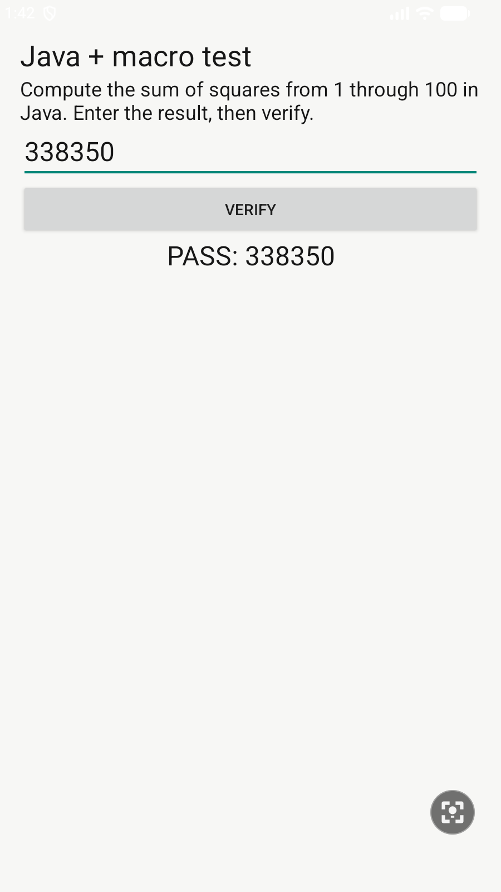

# On-device Java and macro smoke test

On 2026-10-15, the signed-in Android app completed the offline fixture Goal in two model steps: one `run_code` response and one screenshot-verifying `done` response. The generated code was compiled and converted to DEX on the device. Its three guarded operations ran locally in about two seconds, with no model request between them.

The resulting screen displayed `PASS: 338350`. The test used only the separate fixture app; PC commands installed the build, selected the fixture and pressed the app’s own Play control. There was no PC bridge for compilation, inference, code execution or device actions.

The model generated this Java method body:

```java
int sum = 0;
for (int i = 1; i <= 100; i++) { sum += i * i; }
JSONArray actions = new JSONArray();
actions.put(new JSONObject().put("type", "tap").put("x", 70).put("y", 270).put("expect_package", "dev.androiduse.tests").put("expect_text", "Result").put("delay_ms", 300));
actions.put(new JSONObject().put("type", "text").put("text", String.valueOf(sum)).put("expect_package", "dev.androiduse.tests").put("delay_ms", 300));
actions.put(new JSONObject().put("type", "tap").put("x", 70).put("y", 375).put("expect_package", "dev.androiduse.tests").put("expect_text", "VERIFY").put("delay_ms", 500));
ctx.macro(actions);
return sum;
```

Selected execution events:

```text
22:40:10  run_code
22:40:10  Running Java
22:40:10  Result: 338350
22:40:11  Macro 1/3 · tap
22:40:11  Macro 2/3 · text
22:40:11  Macro 3/3 · tap
22:40:12  Macro completed: 3 actions
22:40:13  Step 2 · Observing screen
22:40:17  Completed: screen verified PASS: 338350
```

This is a functional smoke test on the Android API 36.1 emulator, not a security proof or cross-device performance benchmark. JVM and native negative tests separately cover the API allowlist, quotas, JSON bounds and cancellation. See [architecture and limits](automation.md).


